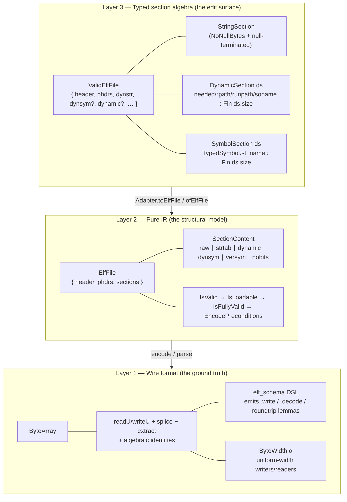
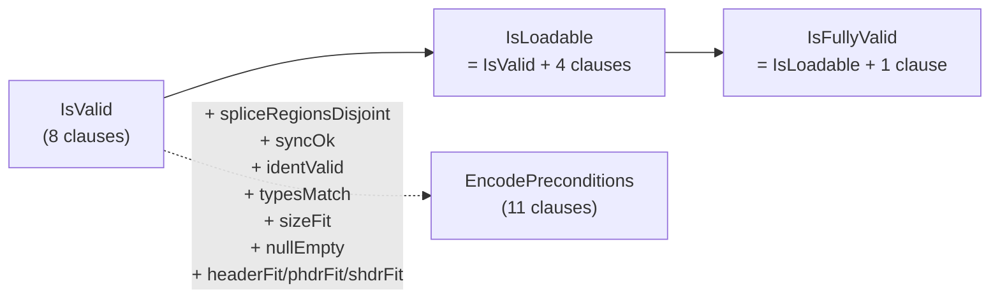
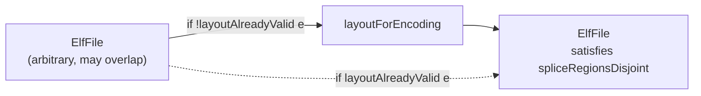
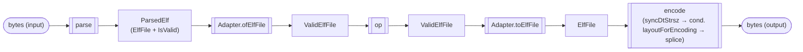
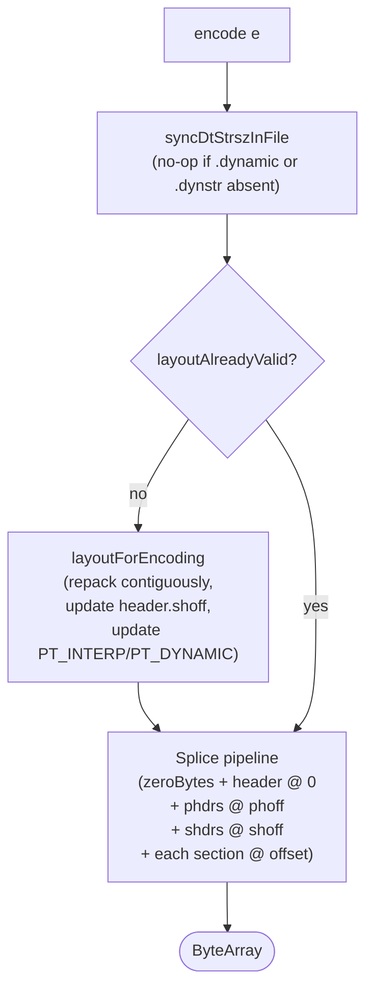

# patchelf (Lean 4 port) — architectural model

This document describes the **structure** of the Lean rewrite — how the
ELF specification is modeled, how operations compose, and what the
verification surface looks like. For *what is currently done vs. not
done*, see [`STATUS.md`](STATUS.md). For forward work,
[`research/ROADMAP.md`](../research/ROADMAP.md). For a full inventory of
every theorem/definition by file, [`INVENTORY.md`](INVENTORY.md).

---

## The three-layer model

The ELF specification is not a single Lean type. It is a **three-layer
stack** of refinements connected by total functions and machine-checked
roundtrip theorems.



Each layer is **strictly more typed** than the one beneath. Cross-layer
movement is by total functions with proven roundtrip properties; there
are no escape hatches and no `sorry`.

### Layer 1 — Wire format

The ground truth is `ByteArray`. We don't redefine ELF; we *encode*
into and *decode* out of it. The codec layer is built bottom-up:

| File | What it provides |
|---|---|
| `Reader.lean`, `Writer.lean` | `readU{8,16,32,64}` / `writeU{8,16,32,64}` (little-endian) |
| `Splice.lean` | `splice` (in-place region write), `splice_*_disjoint`, `splice_*_inside` |
| `ByteLevel.lean` | Read-after-write identities: `readU64_writeU64`, `writeU64_readU64_extract`, `readU32_writeArray`, …; `ByteWidth α` bundle (uniform-width writer/reader/extract identity) |
| `Serialize.lean` | `writeArray` + uniform-width size lemma |
| `Decode.lean` | `buildArray`, `decodeChain`, `decodeStringTable`, `decodeVersym`, `decodeSysVHash`, `decodeGnuHash` |
| `SchemaDSL.lean` | The `elf_schema` command elaborator |
| `Schemas.lean` | DSL invocations for `ElfIdent`, `ElfHeader`, `ProgramHeader`, `SectionHeader`, `DynEntry`, `Symbol`, `Vernaux` |

The schema DSL is what pins down the **Linux + glibc ELF64 binary
layout** — field offsets, widths, endianness, enum encodings (OsAbi,
DynTag) — once per struct, machine-verified bidirectionally. Per
schema invocation it auto-emits:

- `T.write : T → ByteArray`
- `T.decode : ByteArray → Nat → T`
- `T_decode_write : T.decode (T.write t) 0 _ = t`
- `T_write_decodeT_extract : extract-form reverse roundtrip` (e.g. `DynEntry_write_decodeDynEntry_extract`)
- A `ByteWidth T` bundle (when fixed-width)

`ByteRoundtrip.lean` lifts these per-struct facts into the master
encoder/parser roundtrip — see Layer 2.

### Layer 2 — Pure IR

The *structural* model: an ELF file is a header + array of program
headers + array of sections.

```lean
structure ElfFile where
  header   : ElfHeader
  phdrs    : Array ProgramHeader
  sections : Array Section          -- shdr + SectionContent
```

`SectionContent` is an ADT with six cases (`raw | strtab | dynamic |
dynsym | versym | nobits`). There is **no `bytes` field on `ElfFile`**
— bytes only exist at the Layer 1 boundary. `parse : ByteArray →
Except ParseError ParsedElf` produces an `ElfFile` bundled with its
`IsValid` witness; `encode : ElfFile → ByteArray` runs the inverse
splice pipeline (see [Encoder pipeline](#encoder-pipeline)).

#### The validity ladder

Validity is a **decidable predicate refinement chain** layered on
`ElfFile`:



| Predicate | Adds |
|---|---|
| `IsValid` | header counts consistent · sections[0] = SHT_NULL · strtabs null-terminated · dynamic well-formed · dynsym names in bounds · content matches type · types unique · names unique |
| `IsLoadable` | + sections non-overlapping · PT_INTERP offset agrees · PT_DYNAMIC offset agrees · PT_LOAD vaddr/offset congruent |
| `IsFullyValid` | + DT_* address tags match section offsets / sizes |
| `EncodePreconditions` | 11 decidable clauses including `spliceRegionsDisjoint` (built from the `IntervalDisjoint` primitive over 7 region-pair cases) |

Every predicate has a `Decidable` instance, so they compute. **Two
notes**:

1. `IsLoadable` and `IsFullyValid` are currently *decorative* — they
   are defined but never established by `parse` or preserved by ops.
   See `STATUS.md` for the verification depth gap.
2. `EncodePreconditions` is a sibling bundle, not a strict refinement
   of `IsFullyValid`: it adds `spliceRegionsDisjoint` (which `parse`
   cannot enforce, since spec-valid ELFs may have overlapping
   sections), but doesn't require the DT_* coherence clauses.

#### The master theorem

```lean
theorem parse_encode_roundtrip
    (e : ParsedElf) (hPre : EncodePreconditions e.elf) :
    parse (encode e.elf) = .ok e
```

(`Patchelf.Elf.ByteRoundtrip:2327`). What it actually buys: a
**codec-asymmetry guard** for encoder/parser refactors. It rules out
the silent bug class where the encoder writes pattern A, the parser
reads pattern B, A ≠ B, and the round-trip cancels in shell tests. It
does *not* catch wire-format / spec divergence (a value the kernel
would reject but our parser accepts). See `STATUS.md`'s "what this
theorem actually buys" section for the adversarial reading.

#### The layout engine



`LayoutEngine.layoutForEncoding_produces_spliceRegionsDisjoint`
(`LayoutEngine.lean:672`) is the structural correctness theorem: under
two parser-derivable preconditions (`section[0].type = SHT_NULL` and
`ehdrSize ≤ phoff.val`), the layout pass's output satisfies all 7 of
`spliceRegionsDisjoint`'s sub-clauses. Proven via the `Placement +
PairDisjoint = LayoutInv` motive (~561 LOC; `subst hSize` trick to
sidestep dependent `getElem` issues).

### Layer 3 — Typed section algebra

This is **the domain of patchelf operations**. Cross-section references
are encoded at the *type level*, so a whole class of bugs (dangling
string offsets, stale DT_STRSZ, symbol → name pointing past dynstr) is
unrepresentable:

```lean
structure ValidElfFile where
  header   : ElfHeader
  phdrs    : Array ProgramHeader
  dynstr   : StringSection                          -- typed null-terminated table
  dynsym   : Option (SymbolSection dynstr)          -- TypedSymbol.st_name : Fin dynstr.size
  dynamic  : Option (DynamicSection dynstr)         -- needed/rpath/runpath/soname : Fin dynstr.size
  versym   : Option …
  verneed  : Option VerneedSection
  sysvHash : Option SysVHashSection
  gnuHash  : Option GnuHashSection
  interp   : Option InterpSection
```

A `DynamicSection ds` doesn't store `Array DynEntry` — it stores
high-level fields:

```lean
structure DynamicSection (ds : StringSection) where
  needed   : Array (Fin ds.size)
  rpath    : Option (Fin ds.size)
  runpath  : Option (Fin ds.size)
  soname   : Option (Fin ds.size)
  flags1   : Option UInt64       -- DT_FLAGS_1 (DF_1_NODEFLIB lives here)
  debug    : Option UInt64       -- DT_DEBUG
```

Encoding to `Array DynEntry` happens at the boundary via
`assembleEntries` (`DynamicEncode.lean:132`), with
`assembleEntries_back?_null` proving DT_NULL termination.
**DT_STRTAB / DT_SYMTAB / DT_HASH / DT_GNU_HASH / DT_VERNEED /
DT_STRSZ are derived at encode time, never stored** — so all 7
byte-layer `dynAddressCoherent` clauses are vacuous in the typed world.

`growDynstr` extends `dynstr` and returns a `SizeLE` proof; every
existing `Fin ds.size` rebases via `rebase` (`StringSection.lean:120`,
`DynamicSection.lean:61`, `SymbolSection.lean:37`).

Why this is "two co-equal sources of truth": the **typed algebra is the
edit surface**; the **byte layer is the layout-pinned reference** for
entries the typed layer doesn't model (DT_RELA/REL/JMPREL addresses,
DT_INIT/FINI, ordering of pre-existing dynamic entries, opaque
section contents). `Adapter.patchDynamicEntries` reads the byte side
positionally to preserve those verbatim while applying typed-side
edits.

---

## The pipeline

Patchelf is a transducer from bytes to bytes through the typed
algebra. The single-op path:



`encode` runs `syncDtStrszInFile`, conditional `layoutForEncoding`, and
the splice pipeline internally — it isn't the caller's job to set those
up. See [§ Encoder pipeline (zoom-in)](#encoder-pipeline-zoom-in).

**Multi-op invocations re-parse between ops.** The CLI does not
persist a `ValidElfFile` across ops — it runs `parse → ofElfFile →
op → toElfFile → encode → bytes` and feeds the resulting bytes into
the next op. This trades a redundant parse per op for never having to
prove that op composition preserves the `Adapter`'s
template-extraction invariant.

Each op is a `ValidElfFile → ValidElfFile`. The fact that the pipeline
preserves correctness is not per-op work — it's the composition of:

1. `ofElfFile` and `toElfFile` roundtrip preservation
   (`AdapterRoundtrip.lean`).
2. The encoder pipeline reaching `EncodePreconditions` (`syncOk` from
   `syncDtStrszInFile`, `spliceDisjoint` from `layoutForEncoding`, the
   rest from `encodePreconditions_of_parser` + structure).
3. `parse_encode_roundtrip` (the master theorem).

There is **no per-op roundtrip burden**: each op proves only its
*observable* post-condition.

### Encoder pipeline (zoom-in)



The conditional `layoutForEncoding` preserves byte-for-byte stability
for no-growth ops (e.g. `--set-os-abi`). Both `encodeBody` and `encode`
are `@[irreducible]` with `_eq` unfolding lemmas — convergent
recommendation from EverParse / Narcissus / Lean 4 PR #4061.

---

## Op convention

Every op in `Elf/Ops/` ships **three artifacts**:

1. **A typed transformer** `op : ValidElfFile → … → ValidElfFile`,
   usually with a precondition like `(_h : e.dynamic.isSome)`. Heavier
   ops bundle preconditions: `ClearSymbolVersionOk`,
   `RenameDynamicSymbolsOk`.

2. **An `_observable` theorem** stating the post-condition in
   user-facing terms:
   ```lean
   theorem addNeeded_observable :
       (addNeeded e lib h).dynamic.needed contains (lookupOf lib)
   ```
   For ops with the dynstr-growth and dynamic-map shapes (~9 ops:
   `addNeeded`, `addRpathEntry`, set-modes of `Rpath`/`Soname`,
   `replaceNeeded` grow path; and `addDebugTag`, `noDefaultLib`,
   `removeRpath`, `removeNeeded`, remove-modes of `Rpath`/`Soname`),
   the `growDynstrDynamicOp_observable` and `mapDynamicOp_observable`
   combinators in `ObservableCombinators.lean` supply the shared
   skeleton, and each op proves its op-specific `P` predicate inline.
   Header-only, phdr-only, versym, and rename ops (`setOsAbi`,
   `modifyExecstack`, `setInterpreter`, `clearSymbolVersion`,
   `renameDynamicSymbols`, `replaceNeededReuse`) prove their
   observables directly without the combinators.

3. **A `_*_preserved` simp-lemma family** for fields the op leaves
   alone — `setOsAbi_dynstr`, `setOsAbi_phdrs`,
   `setInterpreter_dynamic`, `clearSymbolVersion_header`, etc. These
   are `@[simp]`-tagged so longer op chains compose by `simp`.

**No `_preserves_valid` theorems are needed.** `ValidElfFile` is typed,
not predicate-bundled — the type itself IS the invariant. Compare to
the byte layer's `IsValid`, which would need explicit preservation
proofs.

The 14 ops in `Elf/Ops/`:

| Op | Precondition | Observable focus |
|---|---|---|
| `setOsAbi` | — | `header.ident.osAbi = abi` |
| `modifyExecstack` | — | (preservation simp lemmas only; no positive observable theorem) |
| `addDebugTag` | `dynamic.isSome` | `dynamic.debug.isSome` |
| `noDefaultLib` | `dynamic.isSome` | DF_1_NODEFLIB bit set in `flags1` |
| `addNeeded` | `dynamic.isSome` | needed list contains lib |
| `addRpathEntry` | `dynamic.isSome` | exactly one of rpath/runpath set to path; the other cleared (per `forceRpath`) |
| `modifyRPath` | `dynamic.isSome` | set or clear, both tags |
| `removeRpath` | `dynamic.isSome` | rpath = none ∧ runpath = none |
| `removeNeeded` | `dynamic.isSome` | no surviving `needed[i]` resolves to `lib` in `e.dynstr` |
| `modifySoname` | `dynamic.isSome` | soname = some name ∨ none |
| `replaceNeeded` | `dynamic.isSome` | needed offset rewritten |
| `clearSymbolVersion` | `ClearSymbolVersionOk` (`hasDynsym`, `hasVersym`) | matching versym entries → VER_NDX_GLOBAL |
| `renameDynamicSymbols` | `RenameDynamicSymbolsOk` (`hasDynsym`, `offsetFits` (newName fits in UInt32), `noGnuHash`) | symbol-name observation |
| `setInterpreter` | — | `interp.path = newPath` |

---

## Verification surface

| Layer | Roundtrip kind | Theorem |
|---|---|---|
| L1 → L1 | per-byte read-after-write | `readUN_writeUN`, `writeUN_readUN_extract` (per width) |
| L1 → L1 | per-struct decode-write | `T_decode_write`, `T_write_decode_extract` (DSL-emitted, 7 structs) |
| L1 ↔ L2 | parse∘encode = id | **`parse_encode_roundtrip`** (master theorem) |
| L1 ↔ L2 | layout reaches `spliceRegionsDisjoint` | `layoutForEncoding_produces_spliceRegionsDisjoint` |
| L2 ↔ L3 | adapter preserves observable fields | `roundtrip_header`, `roundtrip_phdrs`, `ofElfFile_*` (8 lemmas) |
| L3 → L3 | per-op observable | `<op>_observable` × 14 ops |

**No `sorry`, no `axiom`** anywhere in the codebase. Pinned by
`lean/AxiomCheck.lean` and the `grep -rn 'sorry\b' Patchelf/`
build check. Axiom dependencies are the standard `[propext,
Classical.choice, Quot.sound]` plus 3 `bv_decide` axioms for the
readU/writeU primitives.

---

## File map

```
Patchelf/Elf/
├── Layer 1 — wire format
│   ├── Reader.lean, Writer.lean, Splice.lean, Serialize.lean
│   ├── ByteLevel.lean              -- read/write identities + ByteWidth
│   ├── Decode.lean                 -- buildArray, decodeChain, …
│   ├── SchemaDSL.lean              -- elf_schema elaborator
│   └── Schemas.lean                -- 7 DSL invocations
│
├── Layer 2 — pure IR
│   ├── Basic.lean                  -- OsAbi, ElfHeader, DynTag, StringTable, …
│   ├── Layout.lean                 -- byte offsets, fixed sizes, ShType/PhType
│   ├── ElfFile.lean                -- ElfFile, SectionContent, IsValid hierarchy
│   ├── SectionOps.lean             -- update helpers + IsValid preservation
│   ├── ParseHeader.lean            -- header parser
│   ├── Parser.lean                 -- parse : ByteArray → Except _ ParsedElf
│   ├── Encoder.lean                -- encode (with @[irreducible])
│   ├── LayoutEngine.lean           -- layoutForEncoding + structural theorem
│   └── ByteRoundtrip.lean          -- master parse_encode_roundtrip
│
├── Layer 3 — typed section algebra
│   ├── StringSection.lean          -- StringSection + Fin offsets + lookup
│   ├── DynamicSection.lean         -- DynamicSection ds
│   ├── SymbolSection.lean          -- SymbolSection ds
│   ├── AuxSections.lean            -- VerneedSection, SysVHashSection, GnuHashSection
│   ├── InterpSection.lean          -- InterpSection
│   ├── ValidElfFile.lean           -- the edit-surface record + growDynstr
│   ├── DynamicParse.lean           -- byte-layer → typed parser
│   ├── DynamicEncode.lean          -- typed → byte-layer assembler (derives coherence tags)
│   ├── DynamicLemmas.lean          -- syncDtStrsz + helpers
│   ├── Adapter.lean                -- ofElfFile / toElfFile bridge
│   ├── AdapterRoundtrip.lean       -- 8 preservation theorems
│   ├── ObservableCombinators.lean  -- growDynstrDynamicOp + mapDynamicOp
│   └── Ops/                        -- 14 mutating ops
│
└── Patchelf.lean, CLI.lean, Main.lean   -- entry points
```

Total: ~13,700 LOC. Largest files: `ByteRoundtrip.lean` (~2,900) and
`SchemaDSL.lean` (~1,200).
